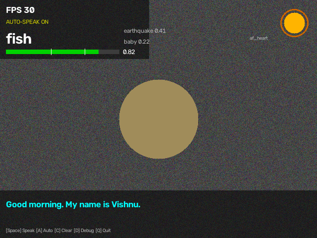
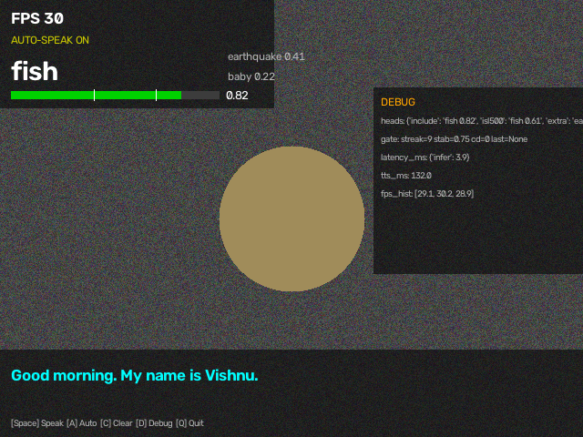
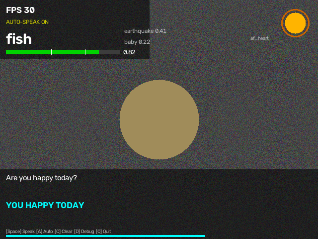
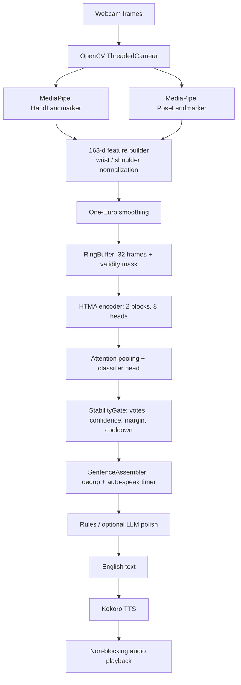

# Real-Time Indian Sign Language Translation


A local, webcam-based system that recognises isolated Indian Sign Language (ISL) signs and turns them into English text and speech. It is built around a custom **HTMA** (Head-Token Mixing Attention) temporal model and runs end to end on a consumer laptop, without the training corpus.

> **Webcam → MediaPipe landmarks → 168-d features → One-Euro smoothing → 32-frame buffer → HTMA encoder → stability-gated words → sentence assembly → Kokoro speech.**

This repository contains two things: the runnable application, and the research record behind it — curated evaluation artifacts, ablations, negative results and design notes. The bundled inference checkpoint is trained exclusively on the CC BY 4.0 [INCLUDE](https://zenodo.org/records/4010759) dataset; raw training data, gated research checkpoints and restricted voices are intentionally **not** distributed.

---

## Screenshots

| Clean HUD | Debug overlay | Sentence assembly |
|:---:|:---:|:---:|
|  |  |  |

*Left: the recognition HUD — top prediction, confidence bar and assembled sentence. Middle: the optional debug panel with per-head outputs, stability-gate state, latency and an FPS trace. Right: the rules-based sentence draft and auto-speak timer before the text is spoken.*

---

## Contents

1. [Problem and objectives](#1-problem-and-objectives)
2. [Key features](#2-key-features)
3. [System architecture](#3-system-architecture)
4. [Model architecture](#4-model-architecture)
5. [Installation and quick start](#5-installation-and-quick-start)
6. [Using the application](#6-using-the-application)
7. [Model and data availability](#7-model-and-data-availability)
8. [Results](#8-results)
9. [Research methodology](#9-research-methodology)
10. [Training and evaluation](#10-training-and-evaluation)
11. [Project milestones](#11-project-milestones)
12. [Limitations and verification status](#12-limitations-and-verification-status)
13. [Attribution and licensing](#13-attribution-and-licensing)
14. [Documentation index](#14-documentation-index)

---

## 1. Problem and objectives

Indian Sign Language is a visual, spatio-temporal language. A sign is not a single image: it is a sequence of hand configurations, movements and upper-body posture over time. Recognising it therefore requires more than frame-by-frame classification.

A conventional image classifier would flicker between labels as a gesture evolves, because consecutive frames of one sign can look like different classes. This project addresses that with a pipeline designed for streams:

- **Temporal modelling** — a 32-frame buffer and an attention-based encoder interpret a sign as a sequence, not a still frame.
- **Temporal smoothing** — a One-Euro filter reduces landmark jitter while staying responsive to fast motion.
- **Stable emission** — a `StabilityGate` requires a dominant class, sufficient confidence and a clear margin over the runner-up before a word is emitted, then applies a cooldown to prevent duplicates.
- **Assembly and speech** — emitted words are deduplicated and accumulated into a sentence, polished by rules (or an optional local LLM), and spoken with offline TTS.

The system deliberately targets **isolated word signs plus sentence assembly**, not continuous sign-language translation. That choice makes it trainable on freely available word-level data while keeping the recognition loop fully local.

## 2. Key features

**Core application**

- Real-time webcam capture with OpenCV (`ThreadedCamera`, 640×480 at 30 fps, always-latest frame).
- MediaPipe Tasks `HandLandmarker` (up to two hands) and `PoseLandmarker` (lite), run asynchronously.
- A fixed **168-dimensional** feature vector per frame: 2 × (21 hand keypoints × 3 + presence) + (13 upper-body pose keypoints × 3 + presence), with wrist- and shoulder-centred normalization.
- Per-dimension **One-Euro smoothing**, a **32-frame ring buffer** with a per-frame validity mask, and inference on every second frame.
- **HTMA** encoder: depthwise temporal Conv1D, multi-token-convolution attention with APE + RoPE, 2 blocks, 8 heads, attention pooling and a classification head.
- **StabilityGate** word emission (majority agreement, confidence and margin checks, cooldown).
- **SentenceAssembler** with consecutive-word deduplication, a 3-second auto-speak timer and a rules-based ISL gloss-to-English renderer (question, negation, time-word and copula rules).
- **Kokoro** offline text-to-speech (`af_heart`) via a non-blocking playback queue; text-only operation with `--no-tts`.
- Live HUD with confidence bar, debug overlay, and a live sentence draft.

**Research and engineering**

- Reproducible training, landmark extraction and evaluation scripts (`scripts/`).
- Temperature calibration, per-source multi-head routing experiments, TTA, adapters, distillation and DPC pretraining probes.
- Curated research evidence: 27 metric files and 3 screenshots under [`docs/research/`](docs/research/README.md).
- Negative results retained deliberately (augmentation regression, CTC collapse, TTA and retrain failures).

**Optional integrations (not bundled)**

- **Kokoro** speech weights download on first use when `requirements-tts.txt` is installed.
- **Qwen2.5-1.5B** local LLM for sentence polish, used only if `models/qwen15b/` is present; otherwise the rules engine is used.
- **Piper** TTS engine is supported in code, but its Lessac voice model is **not** bundled (licensing).

## 3. System architecture



| Module | Responsibility | Source |
|---|---|---|
| Camera and HUD | Threaded frame capture, overlay drawing | [`src/app/`](src/app/) |
| Features | Landmark extraction, normalization, smoothing | [`src/features/`](src/features/) |
| Temporal inference | Ring buffer, stability gate, sentence assembly, routing | [`src/infer/`](src/infer/) |
| Model | HTMA blocks, attention, pooling, classifier factory | [`src/models/`](src/models/) |
| Text and speech | Polish rules, TTS engines, playback queue | [`src/text/`](src/text/), [`src/tts/`](src/tts/) |
| Training and data | Datasets, augmentation, trainer, metrics | [`src/train/`](src/train/), [`src/data/`](src/data/) |
| Configuration and CLI | YAML config merge, demo entry point | [`src/config.py`](src/config.py), [`scripts/demo.py`](scripts/demo.py) |

Further reading: [`docs/architecture.md`](docs/architecture.md) and [`docs/ARCHITECTURE_V2.md`](docs/ARCHITECTURE_V2.md).

## 4. Model architecture

The published model is a plain `HTMAClassifier` ([`src/models/htma.py`](src/models/htma.py)):

1. **Input** — `(B, T, 168)` feature sequences with an optional `(B, T)` validity mask; `T = 32` in the runtime config.
2. **Projection** — a linear layer maps 168 → 256 channels followed by layer normalization.
3. **Position** — sinusoidal absolute position encoding is added to the sequence; rotary positional embeddings (RoPE) are applied to queries and keys inside attention.
4. **HTMA blocks** (×2) — each block contains a depthwise `Conv1D` temporal mixer (kernel 3) with residual, a multi-head attention module whose attention scores are convolved across tokens (`MultiTokenConv`), a GELU feed-forward network, and layer normalization.
5. **Attention pooling** — a single learnable query pools the masked sequence into one vector. Fully masked sequences produce finite output rather than NaNs.
6. **Classifier head** — `Linear → GELU → Dropout → Linear` produces the class logits.

The bundled checkpoint has an **embedding dimension of 256, 2 blocks, 8 attention heads, dropout 0.2 and 264 output classes** (the `configs/isl.yaml` override sets 264; the base config's 263 is for the 263-word INCLUDE label space). It contains roughly **2.03 million parameters** and 65 state tensors. Inference loads its `model_state_dict` strictly after `build_model(config.model)`; the 264-entry label map is read from `models/label_map.json`, and an optional `temperature.json` sidecar can scale logits.

A second, **unpublished** architecture, `MultiHeadHTMAClassifier`, shares the encoder but exposes separate `include`, `isl500` and `extra` heads with max-over-heads routing (about 583 effective words). Its checkpoint was derived partly from gated ISL500 data, so it is **not** included in this repository; the eight-head research results below are reported only as evidence.

> The parser's built-in `--checkpoint` default still points at the excluded research checkpoint. Always pass `--checkpoint models/baseline.pt` explicitly, as in the quick-start commands below.

## 5. Installation and quick start

The supported path is Windows with Python **3.10–3.12** (3.12 recommended) and a webcam. The repository is private, so cloning requires an account with access.

```powershell
git clone https://github.com/vishnu190806/sign-language-translate.git
cd sign-language-translate

# Guided setup: .venv, dependencies, verified MediaPipe models, optional speech
powershell -ExecutionPolicy Bypass -File scripts\setup_runtime.ps1 -WithTTS

# Run the live application with the bundled INCLUDE-only checkpoint
.\.venv\Scripts\python.exe scripts\demo.py --config configs\default.yaml --override configs\isl.yaml --checkpoint models\baseline.pt
```

What the setup script does ([`scripts/setup_runtime.ps1`](scripts/setup_runtime.ps1)):

- Creates `.venv` and installs `requirements.txt`; with `-WithTTS` it also installs `requirements-tts.txt` (Kokoro).
- Downloads `assets/hand_landmarker.task` and `assets/pose_landmarker.lite.task` from Google's official storage and verifies their SHA-256 hashes (`FBC2A300…CDE1` and `59929E1D…574A`). No datasets or gated content are downloaded.
- Confirms `models/baseline.pt` is present. It does not download any checkpoint.

For **text-only** operation, omit `-WithTTS` during setup and add `--no-tts` to the demo command. `run_live_demo.bat` is a convenient Windows launcher that uses `.venv` and selects `models/baseline.pt` automatically. Advanced options and troubleshooting are in [`docs/SETUP.md`](docs/SETUP.md).

## 6. Using the application

Launch the app with the command above (or `run_live_demo.bat`) and allow camera access. Hold a sign steady inside the frame: MediaPipe extracts landmarks, the buffer fills, and after the stability gate agrees on a label the word appears in the sentence bar. Words are appended until a short pause (3 seconds by default) triggers text polish and speech; press `Space` to speak sooner.

| Key | Action |
|---|---|
| `q` | Quit the application |
| `Space` | Speak the current sentence (when TTS is enabled) |
| `a` | Toggle auto-speak on / off |
| `c` | Clear the sentence and reset the gate and frame buffer |
| `d` | Toggle the debug overlay |
| `Backspace` | Remove the last word |

The HUD shows the top prediction, its confidence, the current draft and the auto-speak countdown. The on-screen hint lists all keys except Backspace. Good lighting and a clean background materially improve recognition (see [limitations](#12-limitations-and-verification-status)).

## 7. Model and data availability

**Inference (bundled and runnable).** `models/baseline.pt` — 24,523,349 bytes, SHA-256 `8ED3F773B94B43FF5D772D59F30E64FAC589974EE1F63B9CD243FFC3CB31EB02` — is a plain 264-class HTMA model trained only on INCLUDE landmarks. It is redistributed under the CC BY 4.0 attribution terms of that dataset (see [Attribution](#13-attribution-and-licensing)). Its label map is `models/label_map.json`. The two MediaPipe `.task` models are downloaded and hash-verified by the setup script. Kokoro weights download on first use.

**Training and evaluation (not bundled).** Raw datasets stay out of Git. Obtain them from their official sources:

| Dataset | Purpose | Access | Terms |
|---|---|---|---|
| [INCLUDE](https://zenodo.org/records/4010759) ([HF mirror](https://huggingface.co/datasets/ai4bharat/INCLUDE)) | Core training set; basis of the bundled checkpoint | Open | CC BY 4.0 |
| [ISL500 / ISL-DATA](https://huggingface.co/datasets/ISL500/ISL-DATA) | Signer diversity; gated-data research models | Gated (HF login + terms) | Research/academic only |
| [ISL-CSLTR](https://data.mendeley.com/datasets/kcmpdxky7p/1) | Continuous-data / sentence experiments | Open | CC BY 4.0 |
| [CISLR](https://huggingface.co/datasets/Exploration-Lab/CISLR) | One-shot evaluation / gloss inventory | Gated | AFL-3.0 |
| OpenHands ISL corpus | Aborted DPC pretraining pilot | Local archive only | Distribution terms unresolved in project documentation |

The normal inference demo needs **none** of these datasets. Refer to [`docs/DATASETS.md`](docs/DATASETS.md) and [`docs/MODEL_AND_DATA_AVAILABILITY.md`](docs/MODEL_AND_DATA_AVAILABILITY.md) for acquisition details and the full redistribution assessment.

## 8. Results

All figures below come from the curated artifacts in [`docs/research/evidence/`](docs/research/evidence/); each row states the model and evaluation protocol so results from different experiments are not conflated.

| Model / experiment | Dataset and split | Metric | Result | Evidence |
|---|---|---|---:|---|
| **Published baseline** (`models/baseline.pt`, INCLUDE-only) | INCLUDE held-out test (478 samples, 264 classes) | top-1 / top-5 | **81.80% / 95.40%** | [full_dataset_metrics.json](docs/research/evidence/full_dataset_metrics.json) |
| **Published baseline** | Matched INCLUDE official split (974 of 1,009 rows matched) | top-1 / top-5 | **85.22% / 87.99%** | [official_split_metrics.json](docs/research/evidence/official_split_metrics.json) |
| Multi-head v2 (research, **not shipped**) | Custom split / official split | top-1 | 82.22% / 84.42% | [multihead_v2_gates.json](docs/research/evidence/multihead_v2_gates.json) |
| Published baseline | Real-world cross-dataset (642 clips, mixed sources) | top-1 overall | 22.6% | [real_world_accuracy.json](docs/research/evidence/real_world_accuracy.json) |
| Published baseline | Real-world in-vocabulary subset (387 clips) | top-1 / top-3 / top-5 | 37.47% / 46.51% / 52.45% | [iv_only_metrics.json](docs/research/evidence/iv_only_metrics.json) |
| Multi-head routing (research, **not shipped**) | Real-world (642 clips, overall / IV) | top-1 | 41.0% / 68.0% | [real_world_test_multihead.json](docs/research/evidence/real_world_test_multihead.json) |
| Baseline inference latency | RTX 4070 Laptop, CUDA, batch 1 × 32 frames | p50 / p95 | 18.14 ms / 19.79 ms (~55 FPS) | [bench_v2_baseline_metrics.json](docs/research/evidence/bench_v2_baseline_metrics.json) |
| Sentence polish V2 (LLM available) | 94 sentences | exact / mean F1 | 43.6% / 84.7% | [polish_eval_v2.json](docs/research/evidence/polish_eval_v2.json) |

**Interpretation.** The 81.80% / 85.22% figures are the in-domain performance of the checkpoint that is actually distributed. They do **not** transfer to other data sources: on a mixed real-world set the same model reaches 22.6% overall, and 37.47% even when restricted to words in its vocabulary. The multi-head model improves real-world figures (41.0% overall, 68.0% in-vocabulary) but failed the official-split gate and cannot be redistributed, so it was not shipped. The 0% out-of-vocabulary result is a tautology for a closed-set classifier, not a finding. The sentence-polish score reflects runs where the optional LLM was present; a clean clone uses the rules-only fallback.

Full protocol notes, confidence intervals and caveats are in [`docs/RESULTS.md`](docs/RESULTS.md), with the artifact index in [`docs/research/README.md`](docs/research/README.md).

## 9. Research methodology

The HTMA line of work progressed through several stages, each recorded with its evidence:

- A single-head INCLUDE classifier established the 81.80% baseline, later reproduced as the "champion".
- A tuned-augmentation retrain **failed** (−6.07 points in-domain); adapters and distillation gave no gain, and a joint-softmax variant regressed.
- A shared-encoder **multi-head** model added ISL500 heads for signer diversity and a third head for vocabulary expansion; max-over-heads routing raised the real-world ceiling but the checkpoint was not shippable.
- Temperature scaling (Guo et al., ICML 2017) was fitted per head; a gate sweep retained the existing stability-gate settings.
- Episodic test-time adaptation produced no reliable per-signer gain, and DPC/confusion-driven retrains were aborted after measured regressions.
- Continuous decoding with CTC collapsed into a blank attractor and was parked; see [`docs/CONTINUOUS_PLAN.md`](docs/CONTINUOUS_PLAN.md).

Failures are preserved rather than rewritten as successes. See [`docs/RESEARCH_VALIDATION.md`](docs/RESEARCH_VALIDATION.md) for the citation/evaluation audit and [`docs/PROJECT_TRAJECTORY.md`](docs/PROJECT_TRAJECTORY.md) for the full milestone history.

## 10. Training and evaluation

These scripts reproduce the **pipeline**, not the exact published weights (kernel and data-order nondeterminism apply). They require the datasets from [section 7](#7-model-and-data-availability); setup never downloads them.

```powershell
# Extract 168-d landmarks from INCLUDE videos into data/processed/landmarks/isl
.\.venv\Scripts\python.exe scripts\extract_landmarks.py --dataset isl

# Train the 264-class baseline (override supplies num_classes: 264)
.\.venv\Scripts\python.exe scripts\train.py --config configs\default.yaml --override configs\isl.yaml

# Evaluate on the held-out test split
.\.venv\Scripts\python.exe scripts\evaluate.py --config configs\default.yaml --override configs\isl.yaml --checkpoint models\baseline.pt --split test

# Matched official-split evaluation
.\.venv\Scripts\python.exe scripts\eval_official_split.py --checkpoint models\baseline.pt --label-map models\label_map.json

# Automated test suite
.\.venv\Scripts\python.exe -m pytest tests\ -v
```

The cached replay launcher (`run_demo.bat` / `run_demo.sh`) additionally needs the excluded `isl_40_test/metadata.csv`; the live webcam workflow is the supported path on a fresh clone.

## 11. Project milestones

M0 environment → M1 INCLUDE exploration → M2 landmark extraction → M3 dataloaders and augmentation → M4 HTMA training → M5 real-time loop → M6 sentence assembly and TTS → M7 evaluation → M8 real-world improvement and verified-research upgrade → continuous-sentence programme (CTC parked; rules/LLM assembly shipped). Full detail: [`docs/PROJECT_TRAJECTORY.md`](docs/PROJECT_TRAJECTORY.md).

## 12. Limitations and verification status

**Model and data**

- Recognises isolated word signs, not continuous sign-language sentences; a brief pause between signs is expected.
- Strong in-domain accuracy does not transfer: cross-dataset and unseen-signer performance is much lower, with a large per-signer spread.
- Only 263/264 in-vocabulary classes are predictable; out-of-vocabulary signs cannot be recognised by a closed-set classifier.
- Hand and upper-body pose landmarks only — non-manual cues such as facial expression are not modelled.
- Trained on studio-condition INCLUDE video; lighting, background and occlusion affect results. A Windows `dshow` camera backend is used by default.
- Speech output is English only. Kokoro is the default engine; Qwen polish is optional and the Piper Lessac voice is not distributed.

**What has been verified.** A fresh clone of the published commit installed successfully with `setup_runtime.ps1 -WithTTS`; MediaPipe hashes, checkpoint loading (264 classes), `(1, 32, 168)` inference, hand/pose landmarker initialisation and a Kokoro synthesis smoke test all passed. The automated suite reports **291 passed, 17 skipped, 0 failed**; the skips require excluded research data or the optional `h5py` package. A live webcam run was confirmed to open the camera, capture frames and execute the loop without crashes. **Gesture-triggered word emission and the resulting spoken sentence from a human signer were not performed**, so end-to-end recognition accuracy in a live session remains unconfirmed.

See [`docs/LIMITATIONS.md`](docs/LIMITATIONS.md) and [`docs/QA_REPORT.md`](docs/QA_REPORT.md) for the full record.

## 13. Attribution and licensing

- **INCLUDE** — Sridhar, Ganesan, Kumar & Khapra, ACM MM 2020, CC BY 4.0. The bundled checkpoint is a derived work and is redistributed with this attribution; the source videos are not. Full citation in [`ATTRIBUTION.md`](ATTRIBUTION.md).
- **ISL500 / ISL-DATA** — gated, research/academic only. Redistribution of derived weights is not established, which is why the multi-head checkpoint is excluded.
- **MediaPipe** — Google AI Edge; task models are Apache-2.0 per their model cards (SDK Apache-2.0); downloaded at setup time, not vendored.
- **Kokoro** — `hexgrad/Kokoro-82M`, Apache-2.0 weights, downloaded on first use.
- **Piper** — engine MIT; the `en_US-lessac-medium` voice derives from the Blizzard 2013 Lessac corpus and is licensed for research only with no redistribution grant. It is **not bundled**.
- **Qwen** — separate model licence; optional and not bundled.

No project-level `LICENSE` file is included; the terms above govern the distributed assets.

## 14. Documentation index

- [Research evidence index](docs/research/README.md) — the 27 metric artifacts and 3 screenshots
- [Detailed results](docs/RESULTS.md) and [research validation](docs/RESEARCH_VALIDATION.md)
- [Architecture](docs/architecture.md) and [architecture evolution](docs/ARCHITECTURE_V2.md)
- [Setup](docs/SETUP.md), [datasets](docs/DATASETS.md), [model availability](docs/MODEL_AND_DATA_AVAILABILITY.md)
- [QA report](docs/QA_REPORT.md), [limitations](docs/LIMITATIONS.md), [project trajectory](docs/PROJECT_TRAJECTORY.md)
